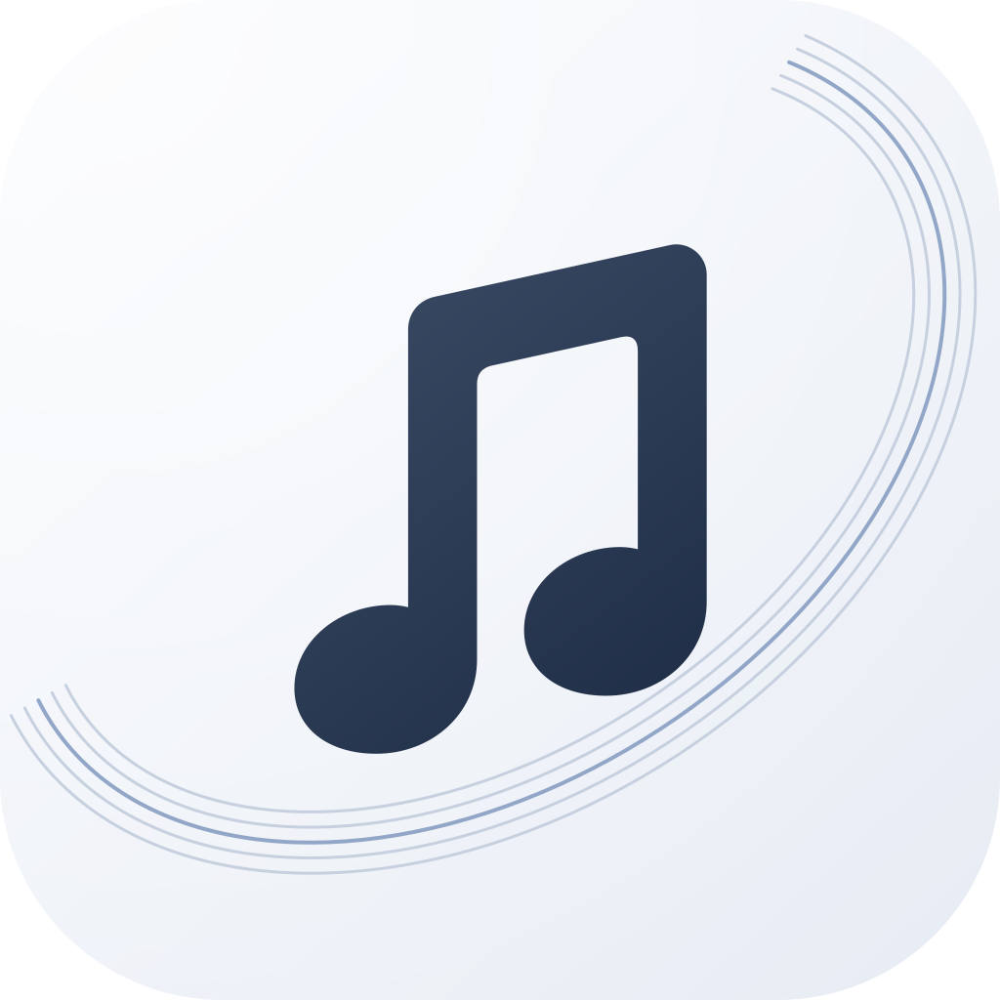

# AMI

[简体中文](#简体中文) · [English](#english)

## 简体中文

AMI 是一款注重歌词、动效与聆听体验的 Android 音乐播放器。可以在手机上登录网易云音乐，浏览收藏专辑、歌单与红心歌曲，也保留本地音乐支持。

- 沉浸式封面与歌词、逐字跟随、按需 AI 翻译和柔和播放控制。
- 液态玻璃与封面取色光晕，清晰、简洁的界面。
- 常听歌曲与封面按需缓存，周、月、年聆听图鉴与手动备份恢复。

**Android 13 及以上。** 不需要 root 或电脑连接端。网易云功能使用兼容协议，遵循账号、会员和歌曲权限，并非官方 SDK；翻译需要自行配置服务密钥。

[下载安装包与更新日志](https://github.com/longzhousz/AMI-Android/releases/latest) · [使用说明](docs/USER_GUIDE.md) · [项目文档](docs/README.md)

## English

AMI is an Android music player built around lyrics, fluid motion, and the listening experience. Sign in to NetEase Cloud Music on your phone to browse saved albums, playlists, and liked songs, or play your local music.

- Immersive artwork and lyrics, word timing, optional AI translation, and gentle playback controls.
- Liquid glass surfaces and artwork-inspired ambient colors in a clean interface.
- On-demand artwork and frequently played audio caching, with weekly, monthly, and yearly listening reports and manual backup and restore.

**Requires Android 13 or newer.** No root or desktop companion is required. NetEase integration uses compatible protocols and respects account and track permissions; it is not an official SDK. Translation requires your own service key.

[Downloads and release notes](https://github.com/longzhousz/AMI-Android/releases/latest) · [User guide (Chinese)](docs/USER_GUIDE.md) · [Project documentation](docs/README.md)

---

Kotlin · Jetpack Compose · Media3. [Development](docs/LOCAL_DEVELOPMENT.md) · [Third-party notices](docs/THIRD_PARTY_NOTICES.md) · [Icon source](design/README.md)

Based on the Android project from [AMI](https://github.com/longzhousz/AMI); maintained here as a standalone application.
