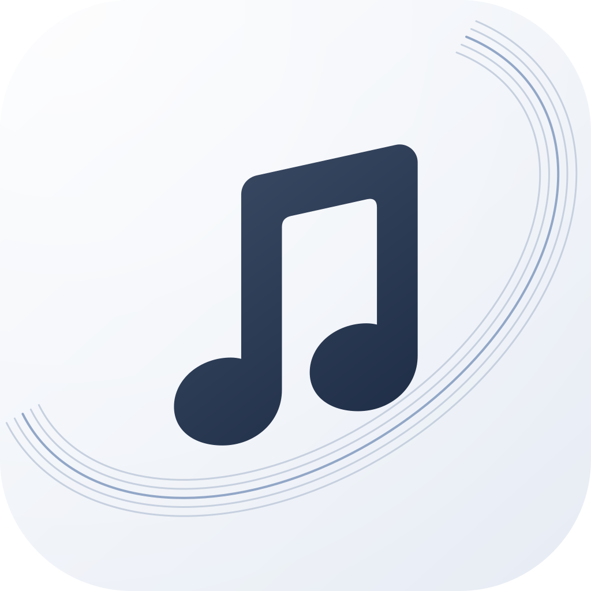

# AMI · Android 音乐播放器

把网易云里点过红心的歌，和手机里珍藏的整张专辑，放进同一个播放器。点开封面，背景光晕随专辑换色；再点一下，歌词就跟着歌声逐字亮起。

**[下载 Android 安装包](https://github.com/longzhousz/AMI-Android/releases/latest)** · [使用指南](docs/USER_GUIDE.md) · [English](#english)

适用于 **Android 13 及以上**。无广告，无需 root 或连接电脑。

## 从哪首歌开始？

- **从网易云收藏里选。** 在 AMI 内登录网易云音乐，即可浏览收藏专辑、自建歌单和红心歌曲。在 AMI 点的红心也会同步回网易云。想听点新的，就打开私人 FM 或每日推荐。
- **从手机里的专辑开始。** 打开「设置 → 本地音乐 → 导入音乐」，选择音乐文件夹。除了 FLAC、MP3 等常见格式，整轨专辑也能按 CUE 索引逐曲播放，原文件保持完整。

## 听歌时的小细节

- **重听一句歌词。** 有逐字时间轴时，每个字会在唱到时亮起。点一句就能跳回去听。长按翻译按钮可选网易云已有译文，也可以用自己的 DeepSeek 密钥按需翻译。
- **沿着封面逛曲库。** 点开网格里的一张封面，它会展开成专辑详情；返回时收回原位，接着就能逛下一张。滚动时，封面的颜色透过悬浮的液态玻璃控件。
- **回看这一周听了什么。** 「设置 → 我的聆听」里有按实际播放时长排出的前十首歌，也有标出听歌日子的日历。周报、月报和年报都在手机上生成。

网易云接入使用非官方兼容协议。可播放的歌曲和音质取决于账号、会员、地区及曲目授权。

## English

**AMI is an Android music player for your NetEase Cloud Music collection and local albums.** Open an album and its artwork expands from the grid. Tap the cover during playback to follow the lyrics, then tap a line to hear it again.

**[Download the APK](https://github.com/longzhousz/AMI-Android/releases/latest)** for Android 13 or newer. AMI runs on your phone, ad-free, without root or a desktop companion.

- **Your library.** Sign in to browse saved albums, playlists you created, and liked songs. Likes sync back to NetEase. For local music, choose a folder in Settings. Play FLAC, MP3, or individual tracks from a single album file with a CUE sheet.
- **Lyrics and translation.** Words light up in time with the vocals when word-level timing is available. Long-press the translation button to choose an available NetEase translation or translate on demand with your own DeepSeek API key.
- **Listening history.** See your most-played tracks by listening time and a calendar of the days you listened. Weekly, monthly, and yearly reports are generated on your device.

The unofficial NetEase integration respects account, subscription, regional, and track permissions.

## 项目与反馈 · Project links

[反馈问题或建议 / Issues](https://github.com/longzhousz/AMI-Android/issues) · [项目文档 / Docs (中文)](docs/README.md) · [本地构建 / Build guide (中文)](docs/LOCAL_DEVELOPMENT.md) · [第三方说明 / Notices](docs/THIRD_PARTY_NOTICES.md)

Built with Kotlin, Jetpack Compose, and Media3. Based on the Android project from [AMI](https://github.com/longzhousz/AMI) and maintained here as a standalone app.
